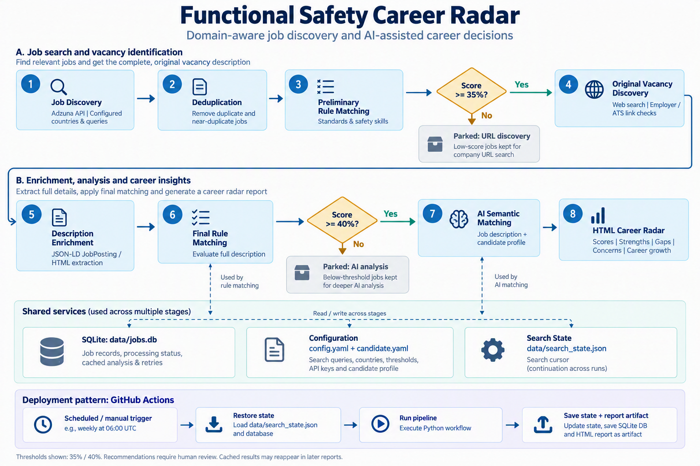
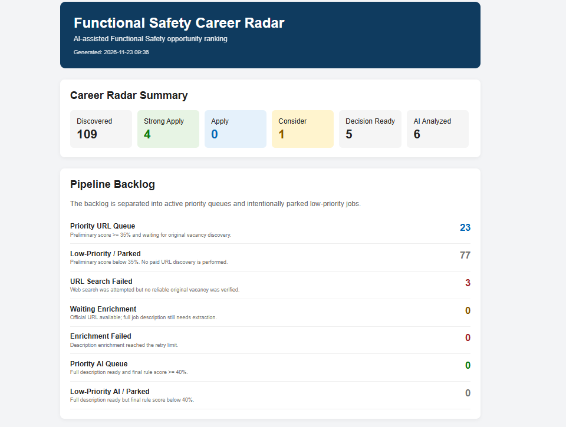

# Functional Safety Career Radar

> Don't apply to more jobs. Apply to the right jobs.

An AI-powered career intelligence agent for Functional Safety engineers.

## What It Does

The agent:

- Searches Functional Safety jobs across multiple countries.
- Removes duplicate vacancies.
- Performs preliminary rule-based matching.
- Finds the original employer vacancy.
- Extracts the full job description.
- Performs final technical matching.
- Uses AI only for relevant opportunities.
- Generates an HTML Career Radar report.

## Pipeline

Job Search
-> Deduplication
-> Preliminary Rule Matching
-> Original Vacancy Discovery
-> Full Description Enrichment
-> Final Rule Matching
-> AI Semantic Analysis
-> Career Radar

## Key Design Principle

The project uses deterministic filtering before expensive AI processing.

- URL discovery threshold: 35%
- AI analysis threshold: 40%
- Persistent SQLite memory prevents repeated analysis.
- API usage is limited per run.

## Current Focus

Version 1 focuses on:

- ISO 26262
- IEC 61508
- ISO 21448 / SOTIF
- HARA
- FMEA / FMEDA
- FTA / DFA
- ASIL
- Safety Case
- Automotive
- Embedded Systems
- Robotics

## Vision

The long-term goal is to evolve this project into a configurable AI Career Radar for specialized engineers.

---

## Core Features

### Multi-Country Job Discovery

The agent searches for engineering opportunities across configurable countries using the Adzuna API.

Example search queries:

- Functional Safety Engineer
- ISO 26262
- IEC 61508

The search strategy uses a persistent cursor, so the system rotates search queries between runs instead of repeating the same search every time.

Example:

Run 1 -> Functional Safety Engineer

Run 2 -> ISO 26262

Run 3 -> IEC 61508

Run 4 -> Repeat cycle

This reduces unnecessary API calls while gradually expanding market coverage.

---

### Domain-Aware Functional Safety Matching

The rule-based matcher understands engineering concepts relevant to Functional Safety, including:

#### Standards

- ISO 26262
- IEC 61508
- ISO 21448 / SOTIF
- ISO 13849
- ISO 10218

#### Safety Engineering Methods

- HARA
- FMEA
- FMEDA
- FTA
- DFA
- ASIL decomposition
- Safety Case
- Safety Planning
- Safety Requirements
- Functional Safety Concept
- Technical Safety Concept

The objective is to perform domain-aware matching rather than simple keyword comparison.

---

## Cost-Aware AI Pipeline

The project intentionally avoids sending every vacancy to AI.

### Gate 1 - Original Vacancy Discovery

Preliminary Rule Score below 35%:

-> Park the vacancy.

Preliminary Rule Score 35% or higher:

-> Continue to original vacancy discovery.

### Gate 2 - AI Semantic Analysis

Final Rule Score below 40%:

-> Park the vacancy.

Final Rule Score 40% or higher:

-> Perform semantic AI analysis.

Typical processing limits per run:

- Job search API calls: 4
- Original URL discovery: 3 jobs
- Description enrichment: 3 jobs
- AI semantic analysis: 3 jobs

This architecture keeps API usage predictable and prevents uncontrolled AI spending.

---

## Original Vacancy Verification

Job aggregators frequently provide incomplete descriptions.

For promising opportunities, the system searches for the original employer vacancy and verifies:

- Company
- Job title
- Location
- Employer career page
- Search confidence

The goal is to evaluate the real employer vacancy rather than relying only on aggregator snippets.

---

## Full Job Description Enrichment

After locating the original vacancy, the system attempts to extract the complete description.

Extraction strategy:

1. JSON-LD JobPosting
2. HTML extraction
3. AI-assisted fallback

The system also tracks enrichment attempts and failures to avoid infinite retry loops.

---

## AI Semantic Matching

Promising vacancies with complete descriptions are compared against a structured candidate profile using semantic AI analysis.

The analysis evaluates:

- Functional Safety technical fit
- Standards alignment
- Safety lifecycle experience
- Safety analysis methods
- Requirements engineering
- Systems engineering
- Software and hardware experience
- Seniority
- Domain alignment
- Required tools
- Education
- Certifications
- Language requirements
- Location and relocation
- Work authorization
- Career-growth potential

The AI returns:

- AI Match Score
- Final Recommendation
- Technical Strengths
- Missing Requirements
- Potential Concerns
- Career Growth
- Why This Job Fits

Possible recommendations are:

- STRONG APPLY
- APPLY
- CONSIDER
- SKIP

---

## Explainable Career Decisions

The project does not stop at a single match percentage.

Instead of only showing:

Match Score: 87%

the Career Radar explains:

- Why the opportunity fits
- Which technical requirements are already covered
- Which requirements are missing
- Which gaps are learnable
- Which gaps may be blockers
- Whether the role matches the candidate's seniority
- Whether the opportunity provides meaningful career growth

The goal is career decision intelligence rather than blind application automation.

---

## Persistent Memory

SQLite acts as the memory of the agent.

The database stores:

- Discovered vacancies
- Duplicate detection state
- Original employer URLs
- URL discovery attempts
- Full job descriptions
- Enrichment retries
- Rule match results
- AI analysis results
- Processing state

This enables behavior such as:

Already discovered?
-> Do not create a duplicate.

URL already searched?
-> Do not repeat the web search.

AI analysis already complete?
-> Reuse the stored result.

The database schema also supports automatic migration of missing columns when the application starts.

---

## Career Radar Report

The final output is an HTML Career Radar.

The summary contains metrics such as:

- Discovered
- Strong Apply
- Apply
- Consider
- Decision Ready
- AI Analyzed

Pipeline state is separated into:

- Priority URL Queue
- Low-Priority / Parked
- URL Search Failed
- Waiting Enrichment
- Enrichment Failed
- Priority AI Queue
- Low-Priority AI / Parked

Each decision-ready opportunity includes:

- Rule Match Score
- AI Semantic Score
- Recommendation
- Matched Standards
- Matched Safety Skills
- Technical Strengths
- Missing Requirements
- Potential Concerns
- Career Growth
- Original Vacancy Link

---

## Project Structure

    functional-safety-career-radar/
    |
    |-- src/
    |   |-- main.py
    |   |-- database.py
    |   |-- matcher.py
    |   |-- ai_matcher.py
    |   |-- deduplicator.py
    |   |-- html_reporter.py
    |   |
    |   |-- ai/
    |   |   `-- openai_provider.py
    |   |
    |   |-- enrichment/
    |   |   |-- url_discovery.py
    |   |   `-- full_description.py
    |   |
    |   `-- searchers/
    |       `-- adzuna.py
    |
    |-- candidate.example.yaml
    |-- config.example.yaml
    |-- requirements.txt
    |-- .gitignore
    `-- README.md

---

## Installation

### 1. Clone the repository

    git clone https://github.com/huzaifa91/functional-safety-career-radar.git

Then enter the project directory:

    cd functional-safety-career-radar

### 2. Create a Python virtual environment

Windows PowerShell:

    python -m venv .venv

Activate it:

    .\.venv\Scripts\Activate.ps1

Linux or macOS:

    python -m venv .venv
    source .venv/bin/activate

### 3. Install dependencies

    pip install -r requirements.txt

---

## Candidate Configuration

Create your personal candidate profile from the public example.

Windows:

    Copy-Item candidate.example.yaml candidate.yaml

Linux/macOS:

    cp candidate.example.yaml candidate.yaml

Then customize candidate.yaml with your own:

- Experience
- Target roles
- Standards
- Safety skills
- Engineering skills
- Tools
- Preferred domains
- Career goals

candidate.yaml is ignored by Git and should remain private.

---

## Search Configuration

Create your local search configuration.

Windows:

    Copy-Item config.example.yaml config.yaml

Linux/macOS:

    cp config.example.yaml config.yaml

The configuration controls:

- Search queries
- Countries
- Results per page
- Search API limits
- URL discovery limits
- Enrichment limits
- AI analysis limits
- Preliminary score threshold
- AI score threshold

config.yaml is ignored by Git.

---

## API Credentials

Create a local .env file containing:

    OPENAI_API_KEY=your_key_here
    ADZUNA_APP_ID=your_app_id_here
    ADZUNA_APP_KEY=your_app_key_here

Never commit the .env file.

The repository .gitignore excludes secrets and private runtime state.

---

## Running the Agent

Run:

    python src/main.py

The pipeline will execute:

Search
-> Deduplication
-> Preliminary Matching
-> Original Vacancy Verification
-> Description Enrichment
-> Final Matching
-> AI Analysis
-> Career Radar

The report is generated at:

    reports/weekly_job_report.html

---

## Automation

The architecture supports automated execution using GitHub Actions.

A typical scheduled execution is:

Scheduled Trigger
-> Set up Python
-> Install Dependencies
-> Restore Persistent State
-> Load GitHub Secrets
-> Run Career Radar
-> Save Updated State
-> Upload HTML Report

API credentials should be stored using GitHub Actions Secrets rather than committed files.

---

## Design Philosophy

The project prioritizes:

- Quality over quantity
- Evidence over assumptions
- Verification before deep AI analysis
- Domain knowledge before generic matching
- Explainability over black-box scoring
- Controlled AI usage over unlimited API calls
- Persistent memory over repeated processing

The objective is not:

"Apply to as many jobs as possible."

The objective is:

"Identify the opportunities where a specialized engineer's time is best spent."

---

## Current Scope

Version 1 focuses on Functional Safety and adjacent specialized engineering roles, including:

- Automotive Functional Safety
- Embedded Systems
- Robotics
- Autonomous Systems
- Semiconductor Safety
- Industrial Functional Safety

---

## Roadmap

### V1 - Functional Safety Career Radar

Completed:

- Multi-country job discovery
- Persistent search cursor
- Deduplication
- Functional Safety rule matching
- Preliminary relevance filtering
- Original vacancy verification
- Full-description enrichment
- Retry handling
- AI semantic matching
- SQLite persistence
- Cost-control thresholds
- Career Radar HTML report
- Cloud-ready automation architecture

### V2 - Configurable Career Agent

Planned:

- CV upload and automatic profile extraction
- Configurable professional domains
- User-defined target roles
- Additional European markets
- Gulf-region job sources
- Salary preferences
- Remote-work preferences
- Email notifications
- New-this-week vs previously-seen opportunities
- Application tracking

### Future Capabilities

Potential future development:

- Resume tailoring per opportunity
- Cover-letter generation
- Application workflow assistance
- Domain plug-ins for specialized professions
- Multi-user web application

---

## Competitive Positioning

Typical AI job-search products optimize for:

Find -> Match -> Apply faster

Functional Safety Career Radar focuses on:

Find
-> Verify
-> Understand
-> Evaluate
-> Prioritize
-> Apply smarter

The key differentiator is domain-aware career decision intelligence for specialized engineers.

---

## Security

The public repository intentionally excludes:

- API credentials
- .env
- candidate.yaml
- config.yaml
- SQLite runtime databases
- Search-state files
- Generated personal reports

Only safe example configuration files are included.

---

## Disclaimer

Job matching and AI-generated recommendations are decision-support signals only.

Always review the original employer vacancy and independently verify the requirements before applying.

---

## Vision

Build a configurable AI Career Radar that helps specialized professionals find fewer, better, and more relevant career opportunities.

---

## Architecture Diagram

The following diagram shows the complete Functional Safety Career Radar pipeline, including rule-based filtering, vacancy enrichment, AI analysis, persistent state, and automation.

---

## Career Radar Example

The Career Radar summarizes discovered opportunities, decision-ready matches, pipeline status, and AI cost-control gates.

